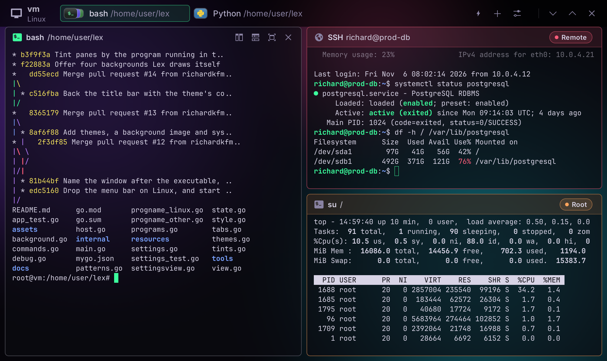

# Lex

A terminal of tabs, split panes and sessions that outlive the app, after
[Superlogical's Rex](https://www.superlogical.com/updates/public-testing-beginning)
and forked from [GoRex](https://github.com/egoist/gorex) by EGOIST. Written in
Go with [MyGo](https://mygo.egoist.dev)'s native UI and its terminal plugin
(Ghostty's libghostty-vt). No webview, no cgo: one ~18 MB app, for Windows,
Linux and macOS.



## What it does

- **Tabs and split panes.** Every pane is a flat card in a hairline rim, the
  focused one in a brighter rim, with its program's icon, name and directory
  in its header, and buttons to split right, split down, zoom and close.
  Drag the gaps between panes to resize them (double-click resets a split
  to half).
- **Persistent sessions.** Shells run in a session server, a background
  process of the same binary (`Lex -server`). Quit Lex and everything
  keeps running; open it again and every tab, split and pane comes back as
  it was, programs still running. The server keeps each session's screen in
  a headless libghostty-vt emulator and sends a snapshot on attach, so
  full-screen programs (lazygit, vim, htop…) come back exactly.
- **Program activity.** The server watches each terminal's foreground
  process (`tcgetpgrp`, `/proc`, `sysctl`, `proc_pidinfo`; on Windows, the
  shell's newest child, its command line and directory): headers and tabs
  name the program (`Node`, `Git Changes` for lazygit, `Codex`, `SSH host`…)
  and its working directory, a green dot shows a program printing, and an
  orange dot marks a pane whose program finished or rang the bell out of
  sight. When the window is in the background, a long command finishing
  posts a notification.
- **Tab icons** stack the tiles of a tab's programs, the focused pane's in
  front, as Rex does: little rimmed cards in their programs' colors, the
  others peeking out behind. Tabs reorder by dragging, rename by double-click, and
  have a context menu.
- **Host chip** with the machine's name and model; its popover shows the
  chip, memory, OS and the session server.
- **Command palette** (Ctrl+Shift+P, or the ⚡ button): every command, and
  every pane to jump to, fuzzy-matched.
- **Six themes**, each coloring the window, the panes and the terminals'
  sixteen colors: **Aurora**, the look of
  [patina](https://github.com/patina-os/patina), true black with neon
  green as the accent and violet as the second color, and **Aurora
  Light** on lavender white; **Ember**, warm amber on charcoal;
  **Tidepool**, aqua on deep ink; **Orchid**, soft rose and lilac; and
  **Paper**, ink on warm paper. Pick one, or match the system's
  appearance with a dark theme and a light one. The theme cards are in
  the settings, and every theme is in the command palette and the View ▸
  Theme menu. KDE's thin Breeze icons on the buttons and
  [Papirus](https://github.com/PapirusDevelopmentTeam/papirus-icon-theme)'s
  glyphs for programs.
- **A background** behind the title bar and the panes, which turn
  translucent over it: one of four patterns Lex draws itself (Nebula,
  Dunes, Dots, Lines), or an image of your own, chosen with the system's
  file dialog, which you fill, fit, tile or center. Set the panes'
  opacity, and how much the background is dimmed (faded in a light
  theme) and blurred. Lex keeps your image's path.
- **Motion, on asking**: off until you turn on *Animate panes and tabs*
  in the Look section of the settings. Panes then glide into place as
  they split, close and zoom, a new pane uncovered by the one making room
  for it, and tabs slide in the way of the tab bar; a pane's terminal
  keeps its size on the way and takes the new one once there, so that its
  program redraws once. Nothing moves while the system asks for less
  motion.
- **Animation panes**: the palette opens a pane beside the focused one
  that plays a scene in place of a terminal (*Animation: Dune Sea*,
  *Neon Grid*, *Garden City*, *Helix*, *Aurora*), which Lex draws on the
  terminal's grid, eight pixels to a cell, as braille's dots, and
  characters for the details, as terminal art does. A larger pane shows
  more of the place: more sky, more dunes, more towers. The places take
  the colors of the theme: sky and shade its second color, their subject
  its accent, lamps its yellow, each keeping its own light, so they stay
  dark in a light theme too (Settings ▸ Look ▸ Motion ▸ *Scenes in theme
  colors*, on unless turned off; Helix is in the theme's colors either
  way). The arrows in its
  header switch scenes, it closes and zooms as any pane, and the layout
  keeps it. It plays while it shows, and holds still while the system
  asks for less motion.
- **An Oh My Posh prompt**, on asking (Text section): new panes'
  shells load your own configuration, and then
  [Oh My Posh](https://ohmyposh.dev), which you install, in Lex's theme:
  two lines, the folder in a pill of the accent, the git branch and its
  state, a long command's time, the user and the clock, past prompts
  shrunk to the folder. Its colors are the terminal's sixteen, so it
  takes the theme of the window and changes with it. Bash, zsh, fish and
  PowerShell; Lex starts them with files of its own (`prompt/` in the
  data directory) that load yours, and changes none of yours.
- **Pane tints**: a pane takes a color of the theme while what runs in
  it is worth keeping in mind: a remote session (ssh, mosh), root (sudo,
  su, doas), a container (docker or podman exec, kubectl exec), or, on
  asking, an AI agent (Claude Code, Codex). The color shows in the rim,
  in the header too with a word naming the kind, or over the whole
  pane, and goes once the program ends. The Panes section of the
  settings turns tints off, all at once or by kind.
- **Fonts**: JetBrains Mono embedded for the terminals, or any of the
  system's monospaced fonts (or all of them, on asking), searchable; the
  rest of the window in the system's font or another. The icons of
  prompts, file listings and editors' status lines come from
  [Nerd Fonts](https://www.nerdfonts.com)' symbols, embedded too, where
  your font has none of its own.
- **Settings** behind the gear of the title bar (Ctrl+Shift+, or
  View ▸ Settings…), in four sections: Look (theme, background and
  motion), Panes (pane tints), Text (fonts, text size (Ctrl+= Ctrl+-
  Ctrl+0), line spacing, the cursor's shape and blinking, ligatures, the
  Oh My Posh prompt), and General
  (the notification of a long command finishing in the background). They show in every
  pane at once and are kept in `settings.json`, in the data directory.

## Install

Every release has a Windows installer, and Linux packages and an AppImage,
for x86-64 (amd64). Download them from the release page, or with the
[GitHub CLI](https://cli.github.com):

```sh
gh release download --repo richardkfm/lex --pattern '*'
```

### Windows

Windows 10 1809 or later. Run `Lex-Setup-<version>-windows-amd64.exe`: it
installs Lex for the current user in `%LOCALAPPDATA%\Programs\Lex`, without
administrator rights, with a Start menu shortcut and an uninstaller in
Settings. The installer isn't signed, so SmartScreen may warn about it:
choose *More info → Run anyway*.

Before you install a new version, run **Quit and End All Sessions** from the
command palette (Ctrl+Shift+P). The session server keeps `Lex.exe` in use,
and the installer can't replace it while the server runs.

### Linux

x86-64 with glibc 2.28 or later (Debian 10, Ubuntu 20.04 and later), GTK 3
and OpenGL. On Debian and Ubuntu, install the package, which puts Lex in
`/opt/lex` and in the applications menu:

```sh
sudo apt install ./lex_<version>_amd64.deb
```

On other distributions, or without root, run the install script as your
user. It installs the archive in `~/.local/lex.app` with its desktop entry
and icon:

```sh
sh install.sh lex-<version>-linux-amd64.tar.gz
```

`sh install.sh --uninstall` removes Lex again, and keeps its settings and
sessions. Neither method adds a `lex` command, because `/usr/bin/lex`
belongs to flex's `lex`. Start Lex from the applications menu, or run
`/opt/lex/lex`.

Or run the AppImage, one file that needs no installing, on any
distribution:

```sh
chmod +x Lex-<version>-x86_64.AppImage
./Lex-<version>-x86_64.AppImage
```

It uses the system's GTK and graphics drivers, as the packages do, and
FUSE to mount itself (`fusermount`, from the `fuse` or `fuse3` package,
which most desktops have). It adds no menu entry by itself: Gear Lever or
AppImageLauncher integrate it, and update it from the `.zsync` of the
latest release. For its icon in the taskbar, it registers a hidden
`lex.desktop` and its icon in `~/.local/share`, as KDE and GNOME look a
Wayland window's icon up by that name, unless a package or `install.sh`
put a `lex.desktop` there. The session server runs from the AppImage too, so keep the
file in one place: replacing it with a new version, or running another
copy, ends the sessions of the one before, as installing a new version
does. `SHA256SUMS` lists the checksums of the files.

## Shortcuts

| Keys | |
|---|---|
| Ctrl+Shift+T | New tab |
| Ctrl+Shift+D / Ctrl+Shift+E | Split right / down |
| Ctrl+Shift+W | Close the pane |
| Ctrl+Shift+Enter | Zoom the pane |
| Alt+arrows | Focus the pane in that direction |
| Alt+Shift+arrows | Move the nearest divider |
| Ctrl+Shift+1…9, Ctrl+PageUp/PageDown, Ctrl+Tab | Switch tabs |
| Ctrl+Shift+R | Rename tab |
| Ctrl+Shift+P | Command palette |
| Ctrl+Shift+K | Clear |
| Ctrl+Shift+, | Settings |
| Ctrl+= Ctrl+- Ctrl+0 | Text size of every pane, kept in the settings |
| Ctrl+wheel | Text size of the pane under the pointer, until Lex restarts |

Ctrl+wheel zooms one pane for a while: changing the text size with
Ctrl+= Ctrl+- Ctrl+0, or any setting, sets every pane back to the
settings' size.

Close Tab, Equalize Panes and Quit and End All Sessions are in the command
palette. Control and a letter are the terminal's (Ctrl+C, Ctrl+D,
Ctrl+W…), so Lex's shortcuts take Shift too, as copying and pasting do
(Ctrl+Shift+C, Ctrl+Shift+V), and none take Control and Alt, which type
characters (AltGr) on many keyboards.

On macOS the shortcuts take ⌘ instead (⌘T, ⌘D, ⇧⌘P…), and the menus
list them all.

## Develop and build

Lex needs [Go](https://go.dev/dl/) 1.27+ and MyGo 0.7, whose CLI
`go.mod` pins as a tool:

```sh
go tool mygo dev     # Lex Dev, rebuilt and restarted as the code changes
go test ./...        # the server, and the view without a window
go tool mygo build   # build/<os>-<arch>/: the app and its packages
go run ./tools/mkicon  # redraw resources/icon.png
sh tools/appimage.sh   # pack the Linux build as an AppImage
```

`go tool mygo build -platform windows/amd64,linux/amd64` builds the Windows
installer and the Linux packages on any machine, without cgo.
`tools/appimage.sh` then packs `build/linux-amd64` as an AppImage on an
x86-64 Linux machine, with appimagetool and the AppImage runtime at the
versions and checksums it pins, and its `.zsync` when `zsyncmake` is
installed (`apt install zsync`). The Windows
installer needs [NSIS](https://nsis.sourceforge.io) (`apt install nsis`,
`brew install makensis`) off Windows.

`go get -tool github.com/egoist/mygo/cmd/mygo@latest` updates MyGo and its
CLI together.

The app keeps its state in its data directory: the server's socket and
log, `layout.json` and `settings.json`, and with the Oh My Posh prompt on,
`prompt/`, the theme and the files that start the shells with it. That is `~/Library/Application
Support/Lex` on macOS, `%AppData%\Lex` on Windows and `~/.config/Lex` on
Linux, and `Lex Dev` for `mygo dev`'s, so that developing never touches the
sessions of the app you use. `LEX_DIR` names another directory, and so does
GoRex's `GOREX_DIR`. The sessions outlive the app, but not a rebuild: a
development build replaces a server that an older build started, ending
its sessions, which then start again in the same directories.

### Windows

Lex runs on Windows 10 1809 or later, whose ConPTY runs the shells. Panes
run `$SHELL` when it names a Windows program (`nu`,
`C:\Program Files\Git\bin\bash.exe`), else PowerShell (`pwsh`, then
`powershell`), else `cmd`. PowerShell's `cd` leaves its process's directory
where it was, so Lex starts it with a prompt that sets it, wrapping the
profile's own prompt: the header then follows it, and new panes open there.
The window is frameless and its title bar draws minimize, maximize and close
with the other buttons; it resizes from its sides and bottom, not its top.

### Linux

Lex runs on GTK 3 and draws with OpenGL (or on the CPU without a GPU). Panes
run your login shell, `$SHELL`, else `/bin/sh`; fish starts without its
greeting, which some distributions make a system summary (CachyOS runs
fastfetch). As on Windows, the window
is frameless and its title bar draws minimize, maximize and close on its
right, beside the other buttons. A Wayland compositor that decorates windows
(KWin, Sway…) is told not to. There is no menu bar: the command palette
(Ctrl+Shift+P) and the shortcuts run every command. The host popover reads the model
from the firmware (`/sys/class/dmi/id`, or the device tree), and the
processor and memory from `/proc`.

### Releasing

Push a tag of the version, or create it with a new release on GitHub
(*Draft a new release*, then a new tag):

```sh
git tag v0.2.0
git push origin v0.2.0
```

[`.github/workflows/release.yml`](.github/workflows/release.yml) checks that
the tag is a version (`vX.Y.Z`), tests Lex on Linux and Windows, builds the
Windows installer, the Linux packages and the AppImage on Ubuntu at the
tag's version, and uploads them with `SHA256SUMS` to the tag's release. When the tag has no
release yet, it makes a draft: review it and publish it. Builds without a
tag, such as pull requests and local builds, take `version` from
`mygo.json`, so bump it now and then to keep it near the releases. The same
build runs for every pull request, and its packages are kept as an artifact
of the run ([`.github/workflows/ci.yml`](.github/workflows/ci.yml)).

## Layout

| | |
|---|---|
| `main.go` | the app, its window, and `-server` |
| `state.go` | tabs, the tree of splits, panes, saving and restoring the layout |
| `view.go`, `tabs.go`, `host.go`, `commands.go`, `settingsview.go` | the interface: title bar, tabs, panes, host popover, menus, palette and settings panel |
| `motion.go` | how panes and tabs move, when the settings animate them |
| `animations.go`, `animscenes.go`, `animcolors.go` | animation panes: the grid they are drawn on, the scenes, and their theme colors |
| `programs.go` | how programs show: names and glyphs |
| `style.go`, `settings.go` | colors, fonts, terminal themes; the settings and how they apply |
| `internal/rex` | the session server and its client: PTYs, foreground processes, headless screens, the socket protocol, and the shells' Oh My Posh prompt (`prompt.go`, `prompt/`) |

Not replicated: Rex's connections to servers on other machines. Lex's
server listens on a local socket only.

## Credits

- **[Superlogical](https://www.superlogical.com)** made
  [Rex](https://www.superlogical.com/updates/public-testing-beginning), the
  terminal whose design and behavior Lex follows. Lex is not affiliated with
  or endorsed by Superlogical. Rex, its name and its design are theirs.
- **[GoRex](https://github.com/egoist/gorex)** by
  [EGOIST](https://github.com/egoist) is the Go replica of Rex that Lex is
  forked from. The session server, the interface and the Windows port are
  EGOIST's work.
- [MyGo](https://mygo.egoist.dev) (MIT), by EGOIST and its contributors, is
  the native UI, the terminal plugin and the build tool.
- [libghostty-vt](https://github.com/ghostty-org/ghostty) (MIT), from
  Ghostty, emulates the terminals.
- [purego](https://github.com/ebitengine/purego) (Apache-2.0),
  [golang.org/x/sys](https://pkg.go.dev/golang.org/x/sys) and
  [golang.org/x/image](https://pkg.go.dev/golang.org/x/image) (BSD-3-Clause),
  and [go-text/typesetting](https://github.com/go-text/typesetting)
  (BSD-3-Clause or Unlicense).
- [patina](https://github.com/patina-os/patina)'s aurora theme
  (GPL-3.0-or-later), by the patina contributors, gives Lex its colors.
- Icons: KDE's [Breeze icons](https://invent.kde.org/frameworks/breeze-icons)
  (LGPL-3.0-or-later), the
  [Papirus icon theme](https://github.com/PapirusDevelopmentTeam/papirus-icon-theme)
  (GPL-3.0; `assets/icons/README.md` lists which is which) and
  [Simple Icons](https://simpleicons.org) (CC0). Font:
  [JetBrains Mono](https://www.jetbrains.com/lp/mono/) (OFL).
